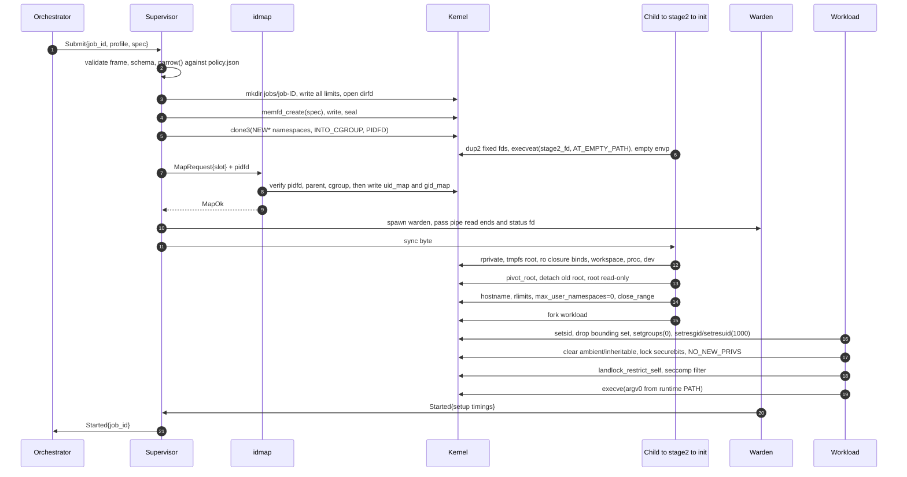
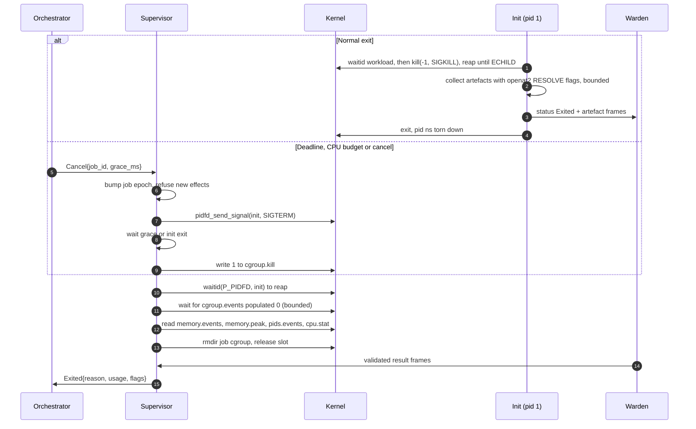

# NixSandbox — System Design

**What it is:** a Linux execution sandbox for code written by LLM agents. A Rust
supervisor assembles each sandbox from kernel primitives: user, PID, mount,
network, IPC, UTS and cgroup namespaces; cgroup v2; Landlock; seccomp-BPF; and
pidfds. Runtimes are immutable and built with Nix. Agents call a small asyncio
Python service.

**Status:** design complete; implementation not started (see §18).

**Companion documents:**
- [literature-review.md](literature-review.md): 19 papers, cited here as [Ln].
- [content-safety.md](content-safety.md): rules that keep the repository free of
  antivirus false positives.

**Conventions:**
- Kernel version numbers are first-mainline releases. They are re-verified in
  milestone M0.
- No performance number appears anywhere in this design. Every number comes
  from the benchmark plan in §15.

## Contents

1. [Summary, goals and key decisions](#1-summary-goals-and-key-decisions)
2. [Threat model](#2-threat-model)
3. [Architecture](#3-architecture)
4. [Kernel baseline and primitives](#4-kernel-baseline-and-primitives)
5. [Privilege model and setup ordering](#5-privilege-model-and-setup-ordering)
6. [Filesystem](#6-filesystem)
7. [Network](#7-network)
8. [Seccomp and Landlock](#8-seccomp-and-landlock)
9. [Runtimes and co-built policy](#9-runtimes-and-co-built-policy)
10. [Resources, lifecycle and cancellation](#10-resources-lifecycle-and-cancellation)
11. [Supervisor internals](#11-supervisor-internals)
12. [Protocol and API](#12-protocol-and-api)
13. [Code layout](#13-code-layout)
14. [Testing and verification](#14-testing-and-verification)
15. [Observability, benchmarks and operations](#15-observability-benchmarks-and-operations)
16. [Failure modes](#16-failure-modes)
17. [Residual risks](#17-residual-risks)
18. [Roadmap, experiments and open decisions](#18-roadmap-experiments-and-open-decisions)
19. [Design decision log](#19-design-decision-log)

---

## 1. Summary, goals and key decisions

```text
agent ──HTTP──▶ orchestrator (Python asyncio; validates, queues, streams; never executes)
                   │ framed protocol over Unix socket (SO_PEERCRED)
                   ▼
              nsbx-supervisor (Rust; no host caps; delegated cgroup; holds authority)
                   ├──▶ nsbx-idmap   (≈300 LOC; CAP_SETUID+CAP_SETGID only)
                   ├──▶ nsbx-warden  (one per job; parses sandbox bytes; ~15 syscalls)
                   ▼ clone3(CLONE_INTO_CGROUP | NEW{USER,PID,NS,NET,IPC,UTS,CGROUP})
              nsbx-stage2 → init (pid 1) → workload (no caps, NNP, Landlock, seccomp)
```

### Goals

| ID | Goal | Evidence |
|----|------|----------|
| G1 | A malicious unprivileged workload cannot read or write host data outside its view, reach host or private network services, or affect other jobs, **unless it exploits a kernel bug** | Probe suite (§14) and design review (§19) |
| G2 | Limits are in force before the first workload instruction, and the workload cannot escape them | `CLONE_INTO_CGROUP` ordering test; cgroup-escape probe |
| G3 | Every exit path tears down completely: processes, mounts, cgroups, fds, UID slot | Cleanup and crash-injection tests |
| G4 | Small, auditable trusted computing base. Host privilege is limited to two capabilities in one helper. Sandbox bytes are parsed only in per-job, confined wardens | LOC budget; `unsafe` confined to one crate |
| G5 | Fail closed. A missing feature or a failed restriction stops the job; nothing runs with weaker protection | Feature-absence VM tests; stage-2 typestate (§5.4) |
| G6 | Reproducible. Runtime and policy are pinned together by Nix store path | `nix build --check`; co-built policy (§9) |
| G7 | Measured. Startup, teardown and throughput have p50/p95/p99 baselines before any optimisation | §15 |

### Non-goals (v1)

- Defence against kernel bugs on the namespace backend. That is what the
  microVM backend is for.
- Multi-host scheduling, Kubernetes, cloud control planes, commercial sandbox
  services.
- Interactive TTY sessions and GPU access.
- **Preventing misuse of authority a job legitimately holds**: exfiltration
  through an allowed egress domain, or over-reaching inside its own workspace.
  NixSandbox bounds the blast radius of code execution; task-scope policy
  belongs to the agent framework above it [L6, L12, L14, L16].

### Key decisions

| Decision | Choice | Main alternative | Why |
|----------|--------|------------------|-----|
| Substrate | Our own assembly of namespaces, cgroup v2, Landlock and seccomp | Docker, podman, bubblewrap, nsjail | Ordering and failure handling must be controlled and testable. bwrap and nsjail are kept as differential-testing references |
| Host privilege | Unprivileged supervisor, delegated cgroup, separate `CAP_SETUID/SETGID` idmap helper | Root daemon; setuid helper | Smallest privileged surface that still gives each job its own host UID range |
| Process creation | `clone3`, then an immediate `execveat` of single-threaded stage 2 | Fork inside Tokio | Post-fork code in a multi-threaded process may only call async-signal-safe functions |
| Resource attach | `CLONE_INTO_CGROUP` | Write PID to `cgroup.procs` later | No window in which the child runs unlimited |
| Kill | PID-namespace init, `cgroup.kill`, pidfds | Signal by PID | Kills the whole tree atomically; no PID reuse |
| Parsing sandbox output | Per-job confined warden | In the supervisor | One job's parser bug cannot reach other jobs or the supervisor's authority |
| Runtime and policy | One Nix derivation produces both | Separately maintained | Policy drift becomes a build failure |
| Default network | Empty netns (loopback only) | Host network + filtering | Nothing to filter if nothing is reachable |
| Backend for untrusted repos | **MicroVM recommended**; namespace backend for single-principal use | Namespace backend everywhere | Frontier models reliably exploit reachable kernel bugs [L1] |

---

## 2. Threat model

### Assets

| Asset | Lives in |
|-------|----------|
| Host files, credentials, home directories | Host mount namespace |
| Host and private network services (metadata endpoints, loopback daemons, RFC 1918 hosts) | Host network namespace |
| Other jobs' inputs and outputs | Other jobs' mount namespaces and cgroups |
| Supervisor authority (socket, idmap channel, cgroup subtree) | Supervisor process |
| Host availability (CPU, memory, PIDs, fds) | Kernel |
| Orchestrator API credentials | Orchestrator |

### Adversaries

| ID | Adversary | Assumed capability |
|----|-----------|--------------------|
| A1 | **Malicious workload** (primary) | Arbitrary native code as the workload UID. Knows this design. Any allowed syscall with any arguments; races; spawns up to the limits; controls every output byte. Willing to spend its whole budget and to crash its own sandbox [L1] |
| A2 | Malicious or confused API client | Any request the orchestrator accepts, including duplicates, floods and cancels |
| A3 | Compromised orchestrator | Valid peer credentials. Can submit anything **policy** allows; cannot change policy |
| A4 | Local unprivileged host user | Can see host `/proc` (subject to `hidepid`); can try the supervisor socket |

**Out of scope:** host root; physical access; nixpkgs supply-chain compromise
(mitigated by pinning and review); microarchitectural side channels on the
namespace backend.

### Boundaries: north and south

Following [L4]:

- The **south** boundary is sandbox → host. That includes files, processes,
  host services, and anything written back that the host later executes.
- The **north** boundary is sandbox → outside world: egress and exfiltration.

Both are default-deny. Write-back is treated as a south-boundary crossing
(§6.5).

### What A1 attempts and what stops it

| Attempt | Primary control (kernel-enforced) | Defence in depth | Residual |
|---------|-----------------------------------|------------------|----------|
| Read host files or credentials | Mount ns + `pivot_root` + old root detached; only allow-listed binds | Landlock; per-slot host UID (DAC) | Kernel VFS/mount bugs |
| Inherit host env | stage 2 runs with empty `envp`; env built only from the allowlist | — | — |
| Inherit host fds | Everything `O_CLOEXEC`; stage 2 `close_range(3, ~0U, 0)` | fd census probe | — |
| Reach host or private network, metadata, loopback services | New empty netns | `socket()` family filter; Landlock TCP (ABI ≥ 4) | Netns-reachable kernel bugs |
| Host abstract Unix sockets | Per-netns abstract namespace | Landlock scoping (ABI 6) | — |
| Escape namespaces | No caps; seccomp blocks `setns`, `unshare`, `mount*`, namespace flags on `clone`; `clone3` returns `ENOSYS` | `max_user_namespaces=0` inside (E3) | Allowed-syscall kernel bugs |
| Dangerous kernel interfaces (`bpf`, `perf_event_open`, `ptrace`, `keyctl`, `userfaultfd`, io_uring, module loading) | Seccomp kill list | Host sysctls checked at startup | — |
| Signal or inspect init / supervisor | Supervisor outside the pidns; init has a different ns-UID and is non-dumpable | Seccomp; Landlock signal scoping | — |
| Exhaust memory, CPU, PIDs, disk, output | cgroup v2 limits; tmpfs sizes; output caps with credits | Aggregate caps on `jobs/` | Unaccounted kernel memory; noisy neighbours |
| Resist termination or leave descendants | `cgroup.kill`; pidns teardown | systemd `KillMode=control-group` | D-state tasks delay cleanup |
| Leave its cgroup | `CLONE_NEWCGROUP`; no cgroupfs mounted; host cgroup files owned by the supervisor UID | Seccomp blocks `mount` | Kernel bugs |
| Attack whoever parses its output | Per-job warden: empty Landlock, ~15-syscall seccomp, Kani-proved decoder | Supervisor relays only validated frames | Warden compromise corrupts only its own job's report |
| Write files the host later runs | Artefacts collected only after all workload processes are dead, with `openat2` `RESOLVE_*` | Write-back guard (§6.5) | Callers that ignore flags |
| Use tools already in the environment | Capability-shaped runtimes (§9.2) | Seccomp | Tools legitimately in the closure |
| Side channels | — | Optional cpuset/SMT isolation | **Accepted** → use the microVM backend |

### Assumptions

1. The kernel is ≥ 6.6, patched, and has the configuration in §4. The supervisor
   verifies this and refuses to start if it is not met.
2. Unprivileged user namespaces are available to the service user. On Ubuntu
   with `apparmor_restrict_unprivileged_userns`, an AppArmor profile is scoped to
   the supervisor binary.
3. systemd with the cgroup v2 unified hierarchy and `Delegate=yes`.
4. Hardened sysctls:
   - `kernel.unprivileged_bpf_disabled ≥ 1`
   - `kernel.perf_event_paranoid ≥ 2`
   - `kernel.io_uring_disabled = 2`
   - `vm.unprivileged_userfaultfd = 0`
   - `fs.protected_symlinks = 1`, `fs.protected_hardlinks = 1`

   Strict mode refuses to start if any differ.
5. `/nix/store` is not secret. The sandbox still sees only its closure.
6. Policy is admin-authored, root-owned, and evaluated only by the supervisor.
7. No repository-supplied configuration (hooks, `.envrc`, `flake.nix`) is ever
   evaluated on the host [L3].
8. Git push, CI triggers and API tokens are capabilities granted **outside**
   the kernel boundary. A sandboxed job that can trigger a pipeline borrows that
   pipeline's credentials [L7].

### Shared kernel vs microVM

| Namespace backend is acceptable when… | MicroVM backend is required when… |
|---------------------------------------|-----------------------------------|
| All jobs act for one principal | Jobs come from mutually distrusting tenants, or from **untrusted repositories** |
| The host holds nothing worth more than the job's inputs | The host holds credentials or signing keys, or is a CI runner with deploy rights |
| No privileged network position | The host is a cloud VM with a meaningful instance role, or sits on an internal network |
| The kernel is patched within days | Patching is slow or out of your control |

Rationale: in [L1], the strongest model solved an eBPF-verifier escape at 1.00
whenever the syscall was reachable, and success grows roughly log-linearly with
the agent's token budget. Seccomp removes the configuration-class escapes; it
cannot remove bugs in syscalls that stay allowed.

---

## 3. Architecture

```mermaid
flowchart LR
    subgraph Agent["LLM agent (untrusted requester)"]
        A["Agent tool call"]
    end
    subgraph Orch["nsbx-orchestrator (Python asyncio, no caps)"]
        API["HTTP API + schema validation"]
        NAR["narrow() via PyO3 (shared verified core)"]
        ADM["Admission: bounded queue + semaphore"]
        JM["Job manager: state, deadlines, cancel"]
        SC["Supervisor client: frames, credits"]
    end
    subgraph Sup["nsbx-supervisor (Rust/Tokio, no caps, delegated cgroup)"]
        PROTO["Protocol server, SO_PEERCRED"]
        POL["Policy engine: co-built policy.json"]
        CG["cgroup manager"]
        POOL["Pre-warmed pool"]
        SPAWN["Spawner: clone3 + execveat"]
        AUTH["Authority: deadlines, cgroup.kill, reaping"]
    end
    subgraph Priv["nsbx-idmap (CAP_SETUID + CAP_SETGID only)"]
        IDM["Write uid_map/gid_map for verified pidfd"]
    end
    subgraph Ward["nsbx-warden (per job, empty Landlock, ~15 syscalls)"]
        WD["Parse status/artefacts, cap output, emit validated frames"]
    end
    subgraph Box["Sandbox (per job)"]
        S2["stage2 then init (pid 1), ns-uid 0"]
        W["Workload, ns-uid 1000, no caps, NNP + Landlock + seccomp"]
    end
    K[("Linux kernel")]
    NIX[("/nix/store: runtime + policy closures")]

    A -- "HTTP" --> API --> NAR --> ADM --> JM --> SC
    SC -- "Unix socket (TB2)" --> PROTO
    PROTO --> POL --> CG --> SPAWN
    POOL --> SPAWN
    SPAWN -- "socketpair (TB3)" --> IDM
    SPAWN -- "clone3 CLONE_INTO_CGROUP" --> S2
    S2 -- "fork + exec" --> W
    W -. "stdout/stderr pipes (TB4)" .-> WD
    S2 -. "status fd (TB4)" .-> WD
    WD -- "validated frames (TB5)" --> AUTH
    AUTH -- "cgroup.kill / pidfd" --> Box
    Box --- K
    NIX -- "ro,nosuid,nodev binds" --> Box
```



### Trust boundaries

| ID | Boundary | Validated by |
|----|----------|--------------|
| TB1 | Agent → orchestrator | Orchestrator: auth, schema, size, rate, `narrow()` |
| TB2 | Orchestrator → supervisor | Supervisor: peer UID, frame bounds, schema, **policy** (re-validates everything) |
| TB3 | Supervisor → idmap | idmap: pidfd liveness, parentage, cgroup path, slot range |
| TB4 | Sandbox → warden | Warden: fixed-size status record, bounded frames, byte caps |
| TB5 | Warden → supervisor | Supervisor: frame type and length only; never interprets sandbox content |
| TB6 | Workload → kernel | Seccomp, Landlock, namespaces, cgroups, DAC |

### Components

| Component | Responsibility | Never does |
|-----------|----------------|------------|
| Orchestrator | Agent HTTP API, auth, admission, job state, SSE streaming, deadlines, turning client disconnects into cancels | Execute request content: no `subprocess`/`eval`/`pickle`, enforced by lint |
| Supervisor | Policy authority. Turns requests into kernel objects. Owns deadlines, kill and reaping. Manages the pool. Rebuilds its state after a crash | Parse sandbox-originated bytes; run code in a forked child before exec |
| idmap | Writes UID/GID maps for verified children | Anything else; it keeps no state |
| Warden | Parses one job's status and artefacts; enforces output caps | Hold authority; touch the filesystem |
| Stage 2 / init | Mounts, pivot, rlimits, fd closing (typestate-ordered); then PID 1: reaper, signal forwarder, artefact collector | Run untrusted code before every restriction is applied |

### Backends

```rust
pub trait Backend: Send + Sync {
    fn name(&self) -> &'static str;
    fn capabilities(&self) -> BackendCaps;
    async fn prepare(&self, spec: &ValidatedSpec) -> Result<Prepared, SetupError>;
    async fn start(&self, p: Prepared, io: JobIo) -> Result<Running, SetupError>;
    async fn signal(&self, r: &Running, s: Termination) -> Result<(), ControlError>;
    async fn wait(&self, r: Running) -> Outcome;
}
```

| | Namespace | MicroVM (Cloud Hypervisor) | gVisor (future option) |
|---|---|---|---|
| Boundary | Shared kernel, seccomp-reduced | Hardware virtualisation, guest kernel, minimal devices | Userspace kernel |
| Host privilege | Unpriv userns + delegated cgroup + idmap | `/dev/kvm` fd passed into a jailed VMM | runsc |
| Rootfs | Per-path ro binds of the closure | Read-only erofs image built by Nix (no QCOW backing files) | Gofer/bind |
| Control | Pipes + status fd | vsock to stage 2 acting as guest agent | — |
| Known weak points | Kernel bugs in allowed syscalls | VMM/device bugs: both Rust VMMs had escape-class CVEs in 2024–26 [L2] | Compatibility gaps |

The **backend is chosen per profile**, never per request, so a request can
never downgrade.

**MicroVM hardening:**
- The VMM runs inside a namespace sandbox with per-thread seccomp. [L2] found
  that checking only the leader thread misleads.
- Minimal devices: virtio-blk on a read-only erofs image, with no io_uring block
  path; vsock; no virtio-net unless needed.
- The guest never gets `/dev/kvm` or nested virtualisation.
- Cloud Hypervisor, the guest kernel and runtimes are pinned in `flake.lock`,
  with an automated bump and an advisory watcher. [L2] showed downstream pins
  lagging upstream fixes by 399–471+ days.
- Experiment E7 checks whether user namespaces and KVM work together.

### Lifecycle

`Admitted → (PoolClaimed | CgroupReady → Spawned → Mapped → Setup) → Running →
Terminating → Reaped → Cleaned → Reported`. Every state has one undo action, and
undo runs in reverse order (§16).





---

## 4. Kernel baseline and primitives

**Minimum: Linux 6.6 LTS.** **Recommended: 6.12 LTS** (Landlock ABI 5–6).
Architectures: x86_64 and aarch64 only. The x32 and compat ABIs are killed by
seccomp.

| Primitive | Use | Since | Privilege | Required |
|-----------|-----|-------|-----------|----------|
| `clone3` + `CLONE_INTO_CGROUP` + `CLONE_PIDFD` | Atomic creation in namespaces and cgroup | 5.3 / 5.7 | Userns rules | Yes |
| User ns | Own ID space and capability scope | 3.8 | Unprivileged if allowed | Yes |
| PID, mount, net, IPC, UTS, cgroup ns | Isolation | ≤ 4.6 | Caps in the owning userns | Yes |
| Time ns | Not used | 5.6 | — | No |
| New mount API (`open_tree`, `move_mount`, `mount_setattr`) | fd-based binds and attributes | 5.2 / 5.12 | Same | Yes |
| `pivot_root` + `MNT_DETACH` | Swap root and drop the old tree | — | Same | Yes |
| UID/GID maps | ns 0 → base, ns 1000 → base+1000 | 3.8 | Multi-range needs `CAP_SETUID/SETGID` (idmap) | Yes |
| `PR_SET_NO_NEW_PRIVS` | Blocks privilege gain on exec | 3.5 | — | Yes |
| seccomp-BPF | Syscall allowlist with argument checks | 3.5; `KILL_PROCESS` 4.14 | NNP | Yes |
| Landlock | Filesystem (+ TCP, scoping) access control | ABI 1: 5.13; 3: 6.2; 4: 6.7; 5: 6.10; 6: 6.12 | NNP | ABI ≥ 3 |
| cgroup v2 memory/cpu/pids, `memory.oom.group`, `memory.peak` | Limits and accounting | 4.5–5.19 | Delegated subtree | Yes |
| `cgroup.kill` | Atomic subtree SIGKILL | 5.14 | Same | Yes |
| `cgroup.events` | Empty notification (inotify) | 4.5 | Same | Yes |
| `cgroup.freeze` | Pause (reserved for future interactive use) | 5.2 | Same | No |
| `pidfd_open`, `pidfd_send_signal`, `waitid(P_PIDFD)` | Race-free process handles | 5.3 / 5.1 / 5.4 | — | Yes |
| `close_range` | Close inherited fds | 5.9 | — | Yes |
| `openat2` `RESOLVE_*` | Symlink-safe file access | 5.6 | — | Yes |
| `proc` `hidepid=invisible,subset=pid` | Minimal `/proc` | 5.8 | — | Yes |
| overlayfs in userns | Workspace layering (future) | 5.11 | Userns caps | No |
| `memfd_create` + seals | Immutable spec handoff | 3.17 | — | Yes |

**Kernel config:** `USER_NS, PID_NS, NET_NS, IPC_NS, UTS_NS, MEMCG,
CGROUP_PIDS, CGROUP_SCHED, CFS_BANDWIDTH, SECCOMP_FILTER, SECURITY_LANDLOCK`
(with `landlock` in `lsm=`), and `TMPFS`.

**Feature detection at startup:**
- **What it checks:** uname/arch; the cgroup2 magic; delegated controllers; a
  probe cgroup create/kill/rmdir; a probe `clone3` into that cgroup; a userns
  probe; the Landlock ABI (`LANDLOCK_CREATE_RULESET_VERSION`); seccomp action
  availability; mounting `proc` with `subset=pid`; the host sysctls; and an
  idmap Hello.
- **What happens on failure:**
  - A missing **required** feature makes the supervisor exit with a diagnostic.
  - A missing **optional** feature disables the profiles that require it.
  - The `landlock` crate runs at its hard-requirement level, never best-effort.
- **Dev mode:** `--insecure-dev-mode` (single-UID map, no idmap) exists only
  behind a Cargo feature that release builds omit, and every result produced
  under it is labelled as such.

---

## 5. Privilege model and setup ordering

### 5.1 Identities

| Process | Host UID | Host caps | cgroup |
|---------|----------|-----------|--------|
| Orchestrator | `nsbx-orch` | none | own unit |
| Supervisor | `nsbx` | none | `nsbx.service/supervisor` |
| Warden (per job) | `nsbx` | none; NNP, empty Landlock, warden seccomp | `nsbx.service/supervisor` |
| idmap | `nsbx-idmap` | `CAP_SETUID`, `CAP_SETGID` (ambient; bounding set = these two) | own unit |
| Stage 2 / init | slot base, e.g. `2_000_000 + slot·65536` | none on the host; full in its own userns | `jobs/job-ID` |
| Workload | slot base + 1000 | none anywhere | same |

There is no root daemon and no setuid binary. Per-slot UID ranges mean that a
mount-namespace escape still meets DAC between jobs and the supervisor.

### 5.2 idmap contract

1. The request arrives as `MapRequest{slot}` plus a pidfd (`SCM_RIGHTS`) over a
   `SOCK_SEQPACKET` socketpair inherited from systemd. The helper has no
   filesystem endpoint.
2. Checks: `slot < slots`; PID taken from fdinfo; `/proc/<pid>` opened as a
   dirfd; `PPid` = supervisor; cgroup under `jobs/`.
3. Writes `gid_map` then `uid_map` (`0 base 1`, `1000 base+1000 1`).
4. Liveness re-check: `pidfd_send_signal(pidfd, 0)`. The helper is stateless,
   single-threaded, `forbid(unsafe)` outside its `sys` module, and runs under
   its own seccomp profile.

### 5.3 Why stage 2 is a separate exec

The supervisor is multi-threaded. After `clone3`, the child performs only
`dup2` calls and `execveat(stage2_fd, "", argv, {NULL}, AT_EMPTY_PATH)`, all on
values prepared beforehand, with no allocation. `stage2_fd` is opened
`O_PATH|O_CLOEXEC` at startup from a store path (E1 tests this).

### 5.4 Ordering, enforced as a typestate

Each step consumes a token type and returns the next one. `exec_workload`
accepts only `Restricted<SeccompApplied>`, so a missing or reordered step
**does not compile**.

| # | Where | Step | Why here |
|---|-------|------|----------|
| 1 | Supervisor | Create cgroup, write **all** limits, open dirfd | Limits exist before any process |
| 2 | Supervisor | `clone3` with all `CLONE_NEW*`, `INTO_CGROUP`, `PIDFD` | Atomic, no migration window |
| 3 | Child | `dup2`s, `execveat(stage2)` | Leave the multi-threaded image |
| 4 | Stage 2 | Block on the sync pipe | Overflow UID; almost powerless |
| 5 | idmap | Write maps | Needs host caps from outside |
| 6 | Stage 2 | `setresuid/gid(0)` in the ns; verify the sealed spec | Caps are now userns-only |
| 7 | Stage 2 | rprivate; build root; `pivot_root`; detach; root read-only | No untrusted code exists yet |
| 8 | Stage 2 | Hostname; rlimits; `max_user_namespaces=0` (E3) | — |
| 9 | Stage 2 | `close_range` except the keep-list | Last point before untrusted code |
| 10 | Stage 2 | `PR_SET_DUMPABLE 0`; `fork` | — |
| 11a | Workload | `setsid` | No controlling TTY |
| 11b | Workload | `PR_CAPBSET_DROP` all (needs `CAP_SETPCAP`) | Before the UID switch |
| 11c | Workload | `setgroups(0)`; `setresgid(1000)`; `setresuid(1000)` | GID before UID |
| 11d | Workload | Clear ambient/inheritable; lock securebits (exact order fixed by E4) | — |
| 11e | Workload | `PR_SET_NO_NEW_PRIVS` | Needed for Landlock and seccomp |
| 11f | Workload | `landlock_restrict_self` | Before seccomp, so seccomp need not allow it |
| 11g | Workload | `seccomp(SET_MODE_FILTER)` | Last restriction |
| 11h | Workload | `execve` | Restrictions are inherited and irreversible |
| 12 | Init | Install the init seccomp profile; supervise | Narrow init for the rest of its life |

A failure at any step makes stage 2 send `SetupFailed{stage, errno}` and
`_exit`. There is no fallback branch anywhere.

| Phase | Host caps | Userns caps | NNP | Landlock | Seccomp |
|-------|-----------|-------------|-----|----------|---------|
| idmap | SETUID, SETGID | n/a | no | no | own |
| supervisor, warden | none | n/a | yes | warden: empty | own |
| stage 2 | none | full | yes (inherited) | no | no |
| init | none | full (needed for `kill(-1)` across UIDs; open decision D5) | yes | no | init profile |
| workload | none | none | yes | yes | workload profile |

---

## 6. Filesystem

### 6.1 View

The root is a fresh tmpfs (`size=1m`), made read-only after setup.

| Path | Source | Flags |
|------|--------|-------|
| `/nix/store/<path>` (each closure path) | host store | bind, `ro,nosuid,nodev`, exec |
| `/bin`, `/usr/bin/env` | symlinks into the runtime env | — |
| `/etc` | runtime skeleton (passwd/group with 0 and 1000, empty `resolv.conf`, `hosts` localhost only) | `ro,nosuid,nodev,noexec` |
| `/workspace` | tmpfs, `size=` per policy, owned 1000 | `rw,nosuid,nodev`, exec only in build/cli profiles |
| `/tmp`, `/dev/shm` | tmpfs, sized | `rw,nosuid,nodev,noexec` |
| `/dev` | tmpfs + binds of `null zero full random urandom` | `ro,nosuid,noexec` |
| `/proc` | new instance, `hidepid=invisible,subset=pid` | `nosuid,nodev,noexec` |
| `/sys`, cgroupfs, `/dev/pts`, host `/run`, `/home`, `/var` | **not mounted** | — |

### 6.2 Host identity in `/proc`

The default `subset=pid` hides the non-PID entries. Profiles that need a full
`/proc` get masked files. Some host-identifying probes in [L2] (CPU model,
memory size, kernel version, interrupts, disk model and serial, DMI) map to
`/proc`/`/sys` entries. For those:

- `/sys` is never mounted.
- Sensitive `/proc` files are masked with `/dev/null` binds.
- `/proc/meminfo` and `/proc/cpuinfo` are replaced by per-job synthetic files.
  These are generated by stage 2 and report `MemTotal` = `memory.max` and a
  generic CPU model, which also helps runtimes size their heaps correctly.

The kernel version stays visible through `uname`. That is an accepted and
documented leak.

### 6.3 Propagation and binds

- `MS_REC|MS_PRIVATE` on `/` first.
- Every bind goes through `open_tree(CLONE)`, `mount_setattr` and `move_mount`
  onto a target dirfd.
- Sources are validated with `^/nix/store/[0-9a-z]{32}-[^/]+$` and opened with
  `RESOLVE_NO_SYMLINKS`.
- After pivoting, `mountinfo` must equal the expected set *exactly*; a subset
  match is not enough.

### 6.4 Files in and out

- **Inputs** are written by stage 2 with
  `openat2(RESOLVE_BENEATH|NO_SYMLINKS|NO_MAGICLINKS|NO_XDEV)` and
  `O_CREAT|O_EXCL|O_NOFOLLOW`. Paths with `..`, NUL, a leading `/`, more than
  4096 bytes or more than 32 components are rejected.
- **Artefacts** are collected by init *after every workload process is dead*,
  with the same resolve flags. Only regular files are taken, within a total
  byte cap. The bytes go to the warden, not the supervisor.

### 6.5 Write-back guard (south boundary)

Collected artefacts are untrusted. Paths the host might later execute
automatically are flagged in the result as `host_executable_risk: true`:

- `.git/` hooks and config;
- `.envrc`;
- editor and IDE task directories;
- agent instruction files (`AGENTS.md`, `.clinerules/`, …);
- `flake.nix`, CI definitions.

A profile may also refuse them outright. This addresses the pre-trust and
persistence findings in [L3, L4, L8].

### 6.6 Storage bounds

All writable storage is tmpfs, bounded both by `size=`/`nr_inodes=` and by the
job's memcg, because tmpfs pages are charged to it. The validator enforces
`Σ tmpfs ≤ memory.max − headroom`, so filling the disk produces `ENOSPC`, not an
OOM. Disk-backed workspaces are open decision D6.

---

## 7. Network

### 7.1 Default: `network: none`

A new netns containing only `lo`, with no routes and no resolver. `socket()` is
restricted to `AF_UNIX`, plus `AF_INET`/`AF_INET6` in profiles with
`loopback_tcp`. Netlink, packet, ALG, vsock, key and similar families return
`EAFNOSUPPORT`.

Nothing outside is reachable: not metadata endpoints, not host loopback, not
link-local addresses. That is the security property.

### 7.2 Optional: `network: egress-proxy` (M9; stubbed in v1)

```text
workload → 127.0.0.1:3128 → in-sandbox forwarder (init)
         → AF_UNIX bind-mounted socket → host nsbx-egress (UID nsbx-egress) → internet
```

`nsbx-egress` speaks HTTP CONNECT only and rejects every other scheme. Per job
it:

1. matches the host against the profile allowlist, eTLD+1-aware with
   suffix-confusion tests [L18];
2. **resolves the name itself**, unmaps IPv4-mapped IPv6 addresses, and denies
   `0/8, 10/8, 100.64/10, 127/8, 169.254/16, 172.16/12, 192.0.0/24,
   192.168/16, 198.18/15, 224/4, 240/4, ::1, fc00::/7, fe80::/10, ff00::/8`
   plus configured metadata addresses;
3. connects to **that exact address**, so there is no rebinding window;
4. enforces byte and connection quotas, and logs the host, SNI and decision per
   job.

**Kernel backstop:** host nftables rules match `meta skuid nsbx-egress`, drop the
deny ranges, and allow only the profile's ports. A proxy bug therefore still
cannot reach metadata endpoints or private ranges.

**Secrets never enter the sandbox.** When a job needs an API credential, the
proxy injects it into requests to the configured host, with TLS terminated only
for that host. The workload never holds the token [L3, L4, L7].

**Cancellation:** after a cancel, the proxy admits **zero** new CONNECTs for the
job (epoch check, §10.4).

Method- and path-level rules would need general TLS interception. That is a
deliberate non-goal [L13].

---

## 8. Seccomp and Landlock

### 8.1 Seccomp principles

1. **Default `ERRNO(ENOSYS)`**, so runtimes take their documented fallbacks.
2. **Kill list (`KILL_PROCESS`):**
   - `bpf`, `perf_event_open`, `kexec_*`, module loading;
   - `open_by_handle_at`, `name_to_handle_at`;
   - `userfaultfd`, `io_uring_*` (`ENOSYS` instead for the `node` profile,
     because libuv probes it);
   - `keyctl`, `add_key`, `request_key`;
   - `ptrace`, `process_vm_*`;
   - `setns`, `unshare`, `mount`, `umount2`, `pivot_root`, `chroot`, the new
     mount API;
   - `swapon`/`swapoff`, `reboot`, `acct`, `quotactl`, `iopl`/`ioperm`;
   - `syslog`, clock setters.
3. **Arch check first.** A foreign audit arch, x32 bit or compat entry is
   killed.
4. **Register arguments only.** Seccomp cannot dereference pointers, which is
   why `clone3` returns `ENOSYS`.

| Syscall | Rule |
|---------|------|
| `clone` | Allowed only without `CLONE_NEW*` flags |
| `clone3` | `ENOSYS` (libc falls back to `clone`) |
| `socket`, `socketpair` | Family allowlist |
| `ioctl` | `FIONREAD`, `FIONBIO`, `FIOCLEX`, `FIONCLEX`, `TCGETS`, `TIOCGWINSZ` only |
| `prctl` | Named options only |
| `personality` | Query and `PER_LINUX` only |
| `seccomp` | `SET_MODE_FILTER` without `NEW_LISTENER` (adding filters can only narrow) |
| `mbind`, `set_mempolicy`, `sched_setscheduler`, `sched_setattr` | `EPERM` |

### 8.2 Profiles

Profiles are a `base` set plus deltas: `python`, `node`, `build`, `cli`. Each
profile's syscall count is published next to reference points from [L2]
(Firecracker 55, gVisor 84, Docker default 361).

**Derivation:** trace the runtime's conformance corpus in log mode; give every
added syscall a written reason; switch to enforce and re-run; generate the
kill-list matrix test. With co-built policy (§9.1), this happens *inside the
runtime's Nix build*.

**Versioning:** `(name, semver, hash)`. Adding a syscall is a minor version;
removing one is major.

**Compiler:** `seccompiler` (pure Rust), with BPF snapshot tests. Revisit
`libseccomp` under D3.

**Limitations:**
- Entry-only filtering.
- No pointer inspection.
- io_uring bypass, hence blocked outright.
- Filters are irreversible.
- A per-syscall cost, measured.
- Bugs in allowed syscalls remain.

### 8.3 Landlock (defence in depth behind the mount ns)

ABI ≥ 3 required. Rights are requested only up to the detected ABI.

| Path | Rights |
|------|--------|
| Each closure path (generated from `closureInfo`) | read file, read dir, execute |
| `/etc`, `/proc` | read |
| `/workspace` | read/write/create/remove/refer/truncate; execute only in build/cli; no device or socket creation |
| `/tmp`, `/dev/shm` | read/write/create (sockets allowed); no execute |
| Character devices | read/write; ABI 5: no device ioctl |
| ABI 4 network | Handles TCP bind/connect; no rules unless `loopback_tcp` |
| ABI 6 scoping | Abstract Unix sockets and signals |

Landlock does not restrict `stat` or path traversal, and it does not govern
anonymous-memory exec (memfd/JIT).

---

## 9. Runtimes and co-built policy

### 9.1 One derivation, runtime + policy

`mkRuntime { name; packages; profile; }` outputs:

| Output | Derived from |
|--------|--------------|
| `env` | `buildEnv` of the packages |
| `etc` | Generated skeleton |
| `store-paths` | `closureInfo` |
| Landlock rule set, mount list | `store-paths`, mechanically |
| Seccomp BPF + hash | Profile TOML via `nsbx-policy` |
| Conformance trace | `passthru.tests` run in `nsbx` inside a NixOS VM test (needs a KVM builder, E11). An unlisted syscall fails the build |
| `policy.json` | Binds runtime path, BPF hash, Landlock digest and profile version |

The supervisor accepts a `(runtime, policy)` pair only if `policy.json` names
that exact runtime path. The orchestrator's capability vocabulary is generated
from the same files. Policy drift is therefore a build failure, and the
vocabulary the API advertises cannot diverge from what the supervisor enforces
[L3, L11].

### 9.2 Capability-shaped runtimes

| Variant | Contains | Excluded on purpose |
|---------|----------|---------------------|
| `python-compute` | python3, stdlib | shell, coreutils, compilers, network clients |
| `python-tooling` | + coreutils, git | compilers, network clients |
| `node` | nodejs | shell, compilers |
| `build-c` | gcc, make, binutils, coreutils, shell | network clients, package managers |
| `cli-text` | coreutils, grep, sed, jq | interpreters, compilers |

`nsbx-policy closure-audit` diffs each closure's executables against a committed
allowlist, so a nixpkgs bump that adds a binary shows up in review. Smaller
closures also mean fewer binds and therefore faster setup.

### 9.3 Build, cache and version

- **Identity:** the output store path.
- **Cache:** any Nix binary cache (`file://`, attic, nix-serve); no hosted
  service is required.
- **Reproducibility:** CI rebuilds each runtime with `nix build --rebuild`.

The Nix *build* sandbox is unrelated to runtime isolation and guarantees nothing
about it.

---

## 10. Resources, lifecycle and cancellation

### 10.1 cgroup layout

cgroup v2's no-internal-processes rule requires this layout:

```text
nsbx.service/ (Delegate=yes)
├── supervisor/   supervisor + wardens
└── jobs/         subtree_control +memory +pids +cpu; aggregate host-budget caps
    ├── job-<id>/ limits written before clone3
    └── pool-<n>/ pre-warmed entries (strictest limits until claimed)
```

### 10.2 Limits

| Resource | Mechanism | Exceeded → |
|----------|-----------|------------|
| Memory | `memory.max`, `high` = 90%, `swap.max=0`, `oom.group=1` | Whole job OOM-killed → `oom` |
| CPU bandwidth | `cpu.max` | Throttled |
| CPU budget | Poll `cpu.stat usage_usec` every 100 ms | `cgroup.kill` → `cpu_budget` |
| Wall clock | Monotonic timer | Escalation → `wall_timeout` |
| Tasks | `pids.max` | `EAGAIN`; counted, not fatal |
| Storage | tmpfs sizes and inodes | `ENOSPC` |
| Files | `RLIMIT_NOFILE`, `FSIZE`; `CORE=0`, `MEMLOCK=0` | errno / `SIGXFSZ` |
| Output | Byte caps (in the warden), credits | Truncate or kill → `output_limit` |

### 10.3 Output and backpressure

- Pipe read ends live in the **warden**, with `F_SETPIPE_SZ` set.
- Chunks flow warden → supervisor → orchestrator only while that job holds
  credits.
- When credits run out, the warden stops reading and the workload blocks in
  `write`. Deadlines keep running.
- Memory is bounded by `max_jobs × (inflight + buffer)`, and this is checked at
  startup.

### 10.4 Termination, cancel and effect epochs

Each job has an **epoch** counter. Cancel, deadline and revoke all increment it.
Every *effect point* re-checks the epoch immediately before acting:

- new exec during setup;
- egress CONNECT admission;
- artefact export;
- output commit to the orchestrator.

A stale epoch means refuse with no side effect. Signalling the process tree
alone cannot stop an effect already queued; this closes that gap [L12].

Escalation:
1. Epoch bump.
2. `SIGTERM` to init, which forwards `kill(-1, SIGTERM)`.
3. Wait for the grace period (min of request and policy).
4. `cgroup.kill`.
5. Reap via the pidfd.
6. Wait for `populated 0`, bounded by `cleanup_timeout`.
7. Read accounting.
8. `rmdir`.
9. Release the slot.

On timeout the job is reported `cleanup: stuck`, the slot is quarantined, and a
background retry is scheduled.

| Event | Behaviour |
|-------|-----------|
| Cancel before or during setup | Abort at the next step; reverse cleanup; reason `cancelled{stage}` |
| Duplicate cancel | No-op |
| Orchestrator disconnects | Its jobs are cancelled (fail closed; D8) |
| Init or sandbox dies unexpectedly | Reason **`sandbox_died`**, distinct from timeout, and logged as a security-relevant event. [L1] found that agents frequently crash their own sandboxes |
| Supervisor crash | Kernel-derived recovery (§11.2) |

### 10.5 Pre-warmed single-use pool

Per `(runtime, policy)`, the supervisor keeps N entries built up to just before
the workload fork: cgroup, namespaces and slot map created, root view
pivoted, stage 2 parked.

**On claim:**
1. Raise the limits from the pool floor to the job's values (never above the
   profile).
2. Send the sealed spec.
3. Stage inputs and fork.

**Rules:**
- **Single use.** An entry is never returned to the pool.
- **Nothing untrusted runs before the claim.**
- **Strictest limits while parked.**
- **Bounded idle cost.** A TTL and the `jobs/` aggregate cap apply.

Experiment E12 checks whether raising limits on a parked cgroup is free of side
effects. The gain is measured, not assumed (§15).

---

## 11. Supervisor internals

### 11.1 Per-job wardens

For each job, the supervisor `execveat`s a small static `nsbx-warden`.

**What it receives:** the job's pipe read ends and the status fd, over a
`SOCK_SEQPACKET` socketpair. Those are the only fds it holds.

**How it is confined:** NNP, an empty Landlock ruleset (no filesystem at all),
and a seccomp allowlist of about 15 syscalls (`read`, `write`, `ppoll`,
`recvmsg`, `sendmsg`, `close`, `exit_group`, `clock_gettime`, arena
`mmap`/`munmap`, …).

**What it does:** decodes the status record and artefact frames with the
Kani-proved decoder, applies output caps, and emits validated frames.

**Where authority stays:** the supervisor keeps the cgroup, `cgroup.kill`, its
own init pidfd and the deadlines. A compromised warden can falsify only its own
job's report. Experiment E10 covers the allocator's syscalls and where warden
CPU time is accounted.

### 11.2 Crash-only state

The supervisor keeps no state it cannot rebuild:

| State | Rebuilt from |
|-------|--------------|
| Which jobs exist | Directories under `jobs/` |
| Job record (slot, profile, deadline, owner, epoch) | A sealed memfd held in the **systemd fd store** (`FileDescriptorStoreMax=`) |
| Process handles | `pidfd_open` on `cgroup.procs`, cross-checked against the record |
| Limits and usage | cgroup files |

The default after a restart is still "tear everything down" (fail closed), but
the teardown is now exact. The record also makes a "reattach" policy possible,
pending E13 (do pipes and pidfds survive in the fd store across a crash?).

---

## 12. Protocol and API

### 12.1 Agent HTTP API

| Method | Path | Purpose |
|--------|------|---------|
| POST | `/v1/jobs` | Submit → `202 {job_id, state}` |
| GET | `/v1/jobs/{id}` | State and result |
| GET | `/v1/jobs/{id}/events` | SSE: `stdout`, `stderr`, `state`, `policy`, `exit` |
| POST | `/v1/jobs/{id}/cancel` | Idempotent cancel |
| POST | `/v1/run` | Submit + stream |
| GET | `/v1/profiles` | Profiles this principal may use, with limits and the inclusion order |
| GET | `/v1/profiles/{name}/environment` | Machine-readable description of the sandbox (network, writable paths, limits, available tools) for agents to read before acting |
| GET | `/v1/health` | Liveness + `HostFeatures` |

`JobRequest` (pydantic, `extra="forbid"`): `job_id?`, `profile`, `argv`,
`files[{path, content_b64, mode}]`, `stdin_b64?`, `env`,
`limits{wall_ms, cpu_ms, memory_bytes, pids, output_bytes}`, `collect[]`,
`grace_ms`.

**Narrow-only, for every field.** `narrow(profile, principal, request)` is the
single function used by both the orchestrator (via PyO3) and the supervisor. It
returns `effective` with:

```text
effective ⊆ request ⊆ principal-allowed ⊆ admin profile
```

It applies to numeric limits, the network lattice (`none` < `egress-proxy`), the
egress allowlist, `collect` and file path prefixes, env keys, and `argv[0]` ∈
runtime PATH. Widening exists only as an admin policy change [L14, L16, L19].

**Structured denials.** A rejection carries
`{category, code, field, requested, allowed, hint}`, so agents adapt instead of
looping or probing [L5, L16].

**Principal scoping.** Results, idempotency keys and artefacts are keyed by
principal, so a `job_id` alone never grants access [L14].

`JobView.result` contains:
- `reason` ∈ `exited | signaled | wall_timeout | cpu_budget | oom |
  output_limit | seccomp_kill | sandbox_died | cancelled | setup_failed |
  supervisor_shutdown | supervisor_unavailable`;
- exit code or signal;
- usage (`wall_ms`, cpu, `memory_peak_bytes`, `oom_kills`, `pids_limit_hits`);
- output byte counts and truncation flag;
- artefacts `{path, size, sha256, host_executable_risk}`;
- `cleanup`, per-stage `timings_us`;
- runtime store path and `policy.json` hash;
- `insecure_dev_mode`.

### 12.2 Supervisor protocol `nsbx/1`

**Transport:** a systemd-activated `SOCK_STREAM` socket, mode 0660, group
`nsbx-clients`. `SO_PEERCRED` UID must equal the orchestrator UID. The
supervisor uses `read(2)` only, so passed fds are never installed. At most 4
connections.

**Frames:** `len u32 BE | type u8 | payload`, with `len ≤ 65 536`.

| Type | Name | Dir |
|------|------|-----|
| 0x01/0x02 | Hello / HelloAck (version, features, profiles) | C↔S |
| 0x10–0x13 | Submit / Accepted / Rejected / Started | C↔S |
| 0x20 / 0x21 | Output (binary) / Credit | S→C / C→S |
| 0x30 / 0x31 | Cancel / Exited | C→S / S→C |
| 0x32 | Artifact (binary) | S→C |
| 0x33 | PolicyEvent (egress decision, limit hit, cancel ack) | S→C |
| 0x40 | Ping/Pong | both |
| 0x7F | Error, then close | S→C |

**Rules:**
- `Hello` must come first.
- Any unknown type, oversize frame, bad JSON or unknown field gets `Error` and
  the connection is closed; that connection's jobs are cancelled.
- **Idempotency:** a resubmit with the same `job_id` and request hash returns
  the current state; a different hash is a conflict.
- **Credits:** the supervisor never sends more output than the client has
  credited.
- **Slow clients:** 5 s per frame body.
- The decoder is fuzzed **and** Kani-proved (§14.4).

---

## 13. Code layout

```text
crates/
  nsbx-proto       frame codec + types            forbid(unsafe); Kani harnesses
  nsbx-policy      narrow(), profiles → BPF, closure-audit, policy.json   forbid(unsafe); Kani
  nsbx-sys         ONLY unsafe crate: clone3, pidfd, mount API, landlock/seccomp install
  nsbx-cgroup      dirfd-based delegated subtree management
  nsbx-core        Backend trait, job state machine, epochs, slots, pool
  nsbx-supervisor  bin: Tokio server, authority, crash-only state
  nsbx-warden      bin: static, single-threaded, confined parser
  nsbx-stage2      bin: static, single-threaded setup (typestate) + init
  nsbx-idmap       bin: ≈300 LOC id-mapping helper
  nsbx-probe       bin: security probes (content-safety rules apply)
  nsbx-bench       bin: benchmark driver
  nsbx-pyo3        narrow() binding for the orchestrator
python/nsbx_orchestrator/  app, schemas, admission, jobs, supervisor client, streaming, auth
runtimes/  mkRuntime + variants (§9)       policy/  profile and seccomp TOML
nix/       module.nix (users, units, sysctls, nftables), tests/ (VM kernel matrix)
spec/      lifecycle.tla (TLA+ model)
```

**Rust rules:**
- Every `unsafe` block lives in `nsbx-sys`, with a `// SAFETY:` comment and a
  test.
- `panic = "abort"` everywhere.
- Gates: `cargo deny`, `cargo audit`, `cargo vet`, clippy `-D warnings`.

**Python rules:**
- 3.12; `starlette`, `uvicorn` and `pydantic` v2 only.
- `mypy --strict`; ruff `S,B,ASYNC`.
- Banned imports: `subprocess`, `os.system`, `eval`, `exec`, `pickle`,
  `marshal`.
- All queues bounded; slow SSE subscribers are dropped.

**NixOS module:**
- **Supervisor unit:** `Delegate=yes`, `KillMode=control-group`,
  `NoNewPrivileges`, `ProtectSystem=strict`, `ProtectHome`,
  `RestrictAddressFamilies=AF_UNIX`, `SystemCallArchitectures=native`, empty
  `CapabilityBoundingSet`, `FileDescriptorStoreMax`.
- **idmap unit:** `AmbientCapabilities=CAP_SETUID CAP_SETGID` and nothing else.
- **Also:** the socket unit, the hardened sysctls, the egress nftables rules, and
  a kernel ≥ 6.6 assertion.

---

## 14. Testing and verification

Passing tests shows that the tested escape *classes* are blocked on the tested
kernels. It does not prove that no escape exists.

### 14.1 Tiers

| Tier | Runner | Contents |
|------|--------|----------|
| T0 | Any OS | Unit tests: proto, policy, `narrow()`, Python schemas, JobManager with a fake supervisor |
| T1 | Any Linux | proptest/Hypothesis, cargo-fuzz, **Kani proofs**, TLC on the TLA+ model |
| T2 | Self-hosted Linux, userns + delegated cgroup | Rootless (insecure-dev) integration |
| T3 | Self-hosted with KVM | NixOS VM tests: production mode, kernel matrix 6.6 / 6.12 / latest, crash injection, feature-absence VMs, co-built policy traces |
| T4 | Dedicated host | Long fuzzing, 10k-job soak, benchmarks, escape-benchmark-style nightly runs |

A missing runner capability makes the job **fail**, never silently skip.

### 14.2 Probe suite discipline

`nsbx-probe` runs as the workload. One subcommand per property, one JSON result
line. Following [L10, L11], every probe has:

- a **positive control**: the same probe must *succeed* with the relevant layer
  disabled (insecure-dev or test-only ablation), or its failure in production
  counts for nothing;
- a **benign twin**: a legitimate workload that needs the same resource class,
  so the suite reports false blocks next to blocks;
- a **target**: the kernel-object check behind the expectation, not just "the
  probe printed denied".

| Group | Probes (expected result) |
|-------|--------------------------|
| Filesystem | Harness canary unreadable; `mountinfo` exact; writes outside `/workspace` fail; symlinked artefact refused; host-auto-exec artefact flagged |
| Identity and leaks | env exactly the allowlist; fd census 0–2; `/proc` shows only the sandbox; synthetic `meminfo`/`cpuinfo`; the [L2] host-identity probes masked or documented |
| Privilege | All cap sets 0; securebits locked; NNP 1; seccomp 2; init unsignalable |
| Kernel primitives | Each of [L2]'s 14 reachability primitives and each configuration-class escape category from [L1] → **unreachable** (killed, `ENOSYS` or absent) |
| Namespaces and cgroups | userns/mount/net creation blocked; `clone3` `ENOSYS`; `/proc/self/cgroup` = `/`; no cgroupfs |
| Network | Harness listener on host loopback, gateway, link-local and the metadata address: unreachable; abstract socket unreachable; disallowed families `EAFNOSUPPORT` |
| Harness reachability | Supervisor socket, idmap, host gateway services: unreachable ([L1]'s harness shortcuts) |
| Limits | Memory → `oom` (whole job); tmpfs `ENOSPC` without OOM; pids capped; CPU budget; output cap with bounded supervisor RSS |
| Lifecycle | Ignores TERM → timeout; double-forked daemons cleaned; cancel at every setup stage; **self-crash** (workload kills or wedges init) → `sandbox_died`; post-cancel effects = 0 |
| Containment | ToolEmu's six real-VM failure classes [L17], as benign stand-ins: store and host byte-identical afterwards; next job unaffected |

### 14.3 Reliability and differential testing

- **Crash injection:** kill the supervisor or warden at each lifecycle hook;
  expect no leftover processes, cgroups or slots.
- **Fault injection:** a `FaultPlan` injects `EPERM`/`ENOMEM` at every `nsbx-sys`
  call site; expect exact reverse cleanup.
- **Concurrency:** 200 concurrent create/cancel/exit cycles; slots unique;
  exactly one terminal state per job.
- **Protocol abuse:** fuzz corpus, oversize frames, slow-loris clients, wrong
  peer UID, attached fds.
- **Differential:** the same probes under bubblewrap and nsjail. A weaker
  NixSandbox result is a finding.

### 14.4 Verified core

1. **Kani:** for all bounded inputs, if `narrow` accepts, the effective
   configuration is a subset of profile, principal and request. Also: the frame
   decoder never panics and never reads past `len`.
2. **Typestate:** stage-2 ordering is enforced at compile time (§5.4).
3. **TLA+ lifecycle model:** under any interleaving of cancel, deadline, exit,
   supervisor crash and cleanup, every admitted job reaches exactly one terminal
   state, and a slot is never reused before `rmdir`.
4. **Installed ⊆ profile:** a property test compares the *installed*
   configuration (cgroup values read back, BPF hash, Landlock digest,
   `mountinfo`) with the profile, not only the request validation.

---

## 15. Observability, benchmarks and operations

### 15.1 Events and metrics

- **Events:** `tracing` JSON lines: admitted, stage (with duration and errno),
  started, limit, policy (egress decision, cancel ack), exited, cleanup,
  features, protocol reject. Events carry lengths and digests only.
- **Metrics:** OpenMetrics on a local socket, optional: jobs by reason, setup
  failures by stage, cleanup failures, quarantined slots, pool depth, setup and
  teardown histograms.
- **Logging policy:** workload output, argv, env and file contents are never
  logged by default.
- **Denied syscalls:** seccomp kills show up as `seccomp_kill`. A log-mode
  profile variant is used only in VM tests. Host-side `bpftrace` filtered by
  `cgroupid()` is used during development. Nothing is ever added to the sandbox
  for diagnostics.

### 15.2 Benchmarks

**Method:**
- Bare metal; governor `performance`; hardware, kernel, nixpkgs and git revision
  recorded.
- 100 warm-up runs, ≥ 2,000 samples per scenario, 5 runs.
- Report p50/p95/p99/max from HDR histograms.
- A regression counts only if it is outside the run spread on ≥ 3 of 5 runs.

| ID | Scenario |
|----|----------|
| B1 | `true`: cold, warm, **pool** (§10.5); per-stage timings |
| B2 | B1 without restrictions (bench-only build), to isolate restriction cost |
| B3 | Closure-size sweep (10 → 800 paths), which drives decision D1 and is checked against the §9.2 variants |
| B4/B5 | `python3 -c pass` / `node -e 0` in the sandbox vs bare |
| B6 | Syscall-heavy loop with and without seccomp |
| B7 | Concurrency sweep: throughput and latency |
| B8 | 100 MiB output: credit window sweep, including the warden hop |
| B9 | Teardown: normal exit, timeout, cancel with 1,000 tasks |
| B10 | 50 idle sandboxes: per-job memory, per-warden RSS, supervisor RSS |
| B11 | AgentBound-comparable ops (read file, write file, read env, fetch URL) for cross-paper comparison [L6] |

**Tools:**
- `perf stat -G <cgroup>`;
- `perf record`;
- `bpftrace` sched and syscall tracepoints filtered by `cgroupid()`;
- `strace -f -T` on the supervisor in dev VMs;
- `py-spy` on the orchestrator.

### 15.3 Kernel-exposure map

- **Static side:** each `policy.json` lists the profile's allowed syscalls,
  argument constraints and socket families.
- **Dynamic side (opt-in):** a host-side eBPF collector, run by the admin and
  never by the supervisor, counts `raw_syscalls:sys_enter` per job cgroup and
  keeps only per-profile aggregates.
- **Query:** `nsbx exposure --syscall X | --family AF_Y` lists the profiles that
  allow it, the 30-day usage and the number of jobs. This turns a kernel
  advisory into a triage list in minutes [L2].
- **Suggestions:** allowed but unused syscalls appear in a "candidates to drop"
  report. They are never removed automatically; the change goes through the
  §9.1 build.

### 15.4 Forensic replay

If a profile sets `retain_inputs: true` (off by default, with a TTL), the
request and input files are kept in a content-addressed, size-capped local store.

`nsbx replay <job_id>`:
1. rebuilds the exact runtime and policy by store path;
2. runs the job in the **microVM backend** on an isolated forensics host with no
   network;
3. traces from outside the guest and writes a replay report.

Replay is best-effort deterministic. Every investigated incident is reduced to a
regression probe under the content-safety rules.

### 15.5 CI

| Stage | Runner | Contents |
|-------|--------|----------|
| check | Any | `nix flake check --no-build`, fmt, clippy, T0, mypy, ruff, deny, audit, pip-audit |
| build | Linux | All packages and runtimes; rebuild check |
| verify | Linux | Kani, TLC, 5-minute fuzzing per target |
| integration-rootless | Self-hosted | T2 |
| integration-vm | Self-hosted, KVM | T3 (incl. co-built policy traces) |
| nightly | Bare metal | T4; advisory watcher for pinned VMM, kernel and runtimes |

---

## 16. Failure modes

| # | Stage | Failure | Handling | Reason |
|---|-------|---------|----------|--------|
| F1 | Admission | Schema, policy or narrowing violation | Structured `Rejected`; nothing allocated | — |
| F2 | Admission | No slot / busy | `Rejected{admission, retryable}` | — |
| F3 | cgroup | `mkdir` or limit write fails | Release; on `EACCES` the supervisor marks itself degraded | `setup_failed{cgroup}` |
| F4 | Spawn | `clone3` fails | `rmdir`, release | `setup_failed{spawn}` |
| F5 | Spawn | `execveat(stage2)` fails | Reap, `rmdir` | `setup_failed{exec_stage2}` |
| F6 | Map | idmap error or 2 s timeout | `cgroup.kill`, reap, `rmdir` | `setup_failed{map}` |
| F7 | Setup | Any stage-2 step fails, or status EOF without a record | Reap, `cgroup.kill`, `rmdir` | `setup_failed{stage}` |
| F8 | Setup | Hang | Setup deadline → F7 | `setup_failed{timeout}` |
| F9 | Pool | Entry exceeds its TTL or fails its claim check | Tear down; build fresh on demand | — |
| F10 | Run | Exit / signal / OOM / budget / output cap / seccomp kill | Normal teardown | per reason |
| F11 | Run | Init or sandbox dies unexpectedly | pidns teardown, `cgroup.kill`, security event | `sandbox_died` |
| F12 | Warden | Crash or malformed output | Supervisor kills the job; the report is untrusted | `sandbox_died` |
| F13 | Teardown | Cgroup never empties / `rmdir` `EBUSY` | `cleanup: stuck`, quarantine, retry | + `stuck` |
| F14 | Control | Orchestrator disconnects or sends garbage | Cancel its jobs | `cancelled` |
| F15 | Supervisor | Panic (`abort`) or crash | systemd kills the jobs; restart rebuilds state from cgroups and the fd store and tears down exactly | `supervisor_unavailable` |
| F16 | Supervisor | Own cgroup near its memory limit | Stop admitting (`Busy`) | — |
| F17 | idmap | Crash | systemd restart; in-flight jobs → F6 | `setup_failed{map}` |
| F18 | Host | A required feature disappears | Refuse to start; optional ones disable profiles | — |

**Invariants**, checked by tests, TLA+ and the typestate:
1. Every admitted job reaches exactly one terminal reason.
2. After cleanup there is no cgroup, no process with the slot's UIDs, and the
   slot is free.
3. The workload `execve` cannot be reached without every restriction applied.
4. Supervisor RSS stays bounded under any client behaviour.
5. After a cancel ack, there are zero new effects for that job.

---

## 17. Residual risks

1. **Kernel surface** on the namespace backend: hundreds of allowed syscalls,
   tmpfs, procfs, and the code stage 2 reaches with userns caps. This is the
   dominant risk. Mitigations: minimisation, patching, the exposure map and the
   microVM backend.
2. **Unprivileged user namespaces** enabled for the service user. Scope them to
   the supervisor binary where the distro allows it.
3. **VMM and device-model bugs** on the microVM backend [L2]. Mitigated by the
   VMM jail, minimal devices, and the pin-bump plus advisory watch.
4. **Warden compromise.** Bounded to falsifying one job's report; authority stays
   in the supervisor.
5. **Accounting gaps:** unattributed kernel memory, cache and bandwidth
   contention. Aggregate caps limit the blast radius.
6. **memfd/JIT exec** is outside Landlock `EXECUTE`.
7. **Supply chain** for the supervisor's and orchestrator's dependencies. Pinned
   and audited, not eliminated.
8. **Admin policy mistakes.** Narrowed by co-built policy, a linter that flags
   over-broad grants, and an `unsafe_bind` flag that requires a written reason
   and is surfaced in every result.
9. **In-policy misuse** (allowed egress, workspace overreach). Out of scope by
   design (§1). The policy event stream lets callers measure it.

---

## 18. Roadmap, experiments and open decisions

### Milestones

| M | Scope | Acceptance |
|---|-------|------------|
| M0 | Flake, dev shell, CI check; verify every §4 claim in `docs/verification.md`; experiments E1–E7 | Each claim verified or corrected; each experiment written up |
| M1 | `nsbx-proto`, `nsbx-policy`: codec, `narrow()`, profiles → BPF; Kani proofs; PyO3 binding | Proofs pass; property tests; fuzzing clean for 5 minutes per target |
| M2 | `nsbx-sys`, `nsbx-cgroup`; `clone3` into cgroup + userns/pidns + trivial stage 2 | Child is in the job cgroup at its first instruction; `cgroup.kill` empties it; fd census clean |
| M3 | Stage-2 filesystem + typestate; `mkRuntime` with variants and `closure-audit`; synthetic `/proc` | FS, identity and leak probes pass |
| M4 | Privilege drop, Landlock, seccomp; co-built policy with conformance traces | Privilege, primitive and namespace probes pass; Python corpus passes in enforce mode |
| M5 | Supervisor: protocol, wardens, epochs, deadlines, credits, results; init role | Limits and lifecycle probes; bounded RSS; protocol abuse suite |
| M6 | idmap, NixOS module, VM kernel matrix; crash-only state | All T2 tests in T3 on three kernels; crash and fault injection; feature-absence VMs refuse to start |
| M7 | Orchestrator: API, narrowing via PyO3, structured denials, environment endpoint, SSE, cancel propagation | End-to-end HTTP tests; mypy strict; banned-import check |
| M8 | Benchmarks B1–B11 baseline; pool; exposure map; node and build profiles | Baseline JSON with hardware metadata (numbers come only from this run) |
| M9 | Egress proxy, proxy-side secret injection, nftables backstop | Egress probes incl. forced-DNS tests; zero CONNECTs after a cancel |
| M10 | MicroVM backend (jailed VMM, erofs, vsock); forensic replay | Same probe suite through `Backend`; B1/B4/B10 for both backends |

**Vertical slice = M0–M7.** Networking and the microVM backend are stubbed; any
stub returns `unsupported_feature` and never falls back to something weaker.

### Experiments

| E | Question |
|---|----------|
| E1 | Does `execveat(AT_EMPTY_PATH)` of an `O_PATH` fd work from a fresh `clone3` child? |
| E2 | Per-path bind cost vs closure size (decision D1) |
| E3 | Is `max_user_namespaces` per-userns, writable from inside, and effective for descendants? |
| E4 | Securebits vs setuid ordering; resulting cap sets |
| E5 | Do Python, Node and gcc work with `clone3 → ENOSYS`, `subset=pid` and no `/sys`? |
| E6 | `landlock` crate hard-requirement API; `rustix` coverage of the mount API |
| E7 | User namespace + `/dev/kvm` for a jailed VMM |
| E10 | Warden syscall set under static musl; warden CPU accounting placement |
| E11 | KVM-backed conformance traces inside Nix builds (`requiredSystemFeatures`) |
| E12 | Is raising limits on a parked cgroup free of side effects? |
| E13 | Do pipes and pidfds survive in the systemd fd store across a crash? |

### Open decisions (prioritised)

| P | ID | Decision | Leaning |
|---|----|----------|---------|
| 1 | D1 | How the closure is presented | Per-path binds + capability-shaped runtimes, unless E2 says otherwise |
| 2 | D2 | idmap wiring | Separate systemd unit |
| 3 | D3 | Seccomp compiler | seccompiler |
| 4 | D4 | Minimum kernel | 6.6 now; move to 6.12 later |
| 5 | D5 | Init privilege after setup | Minimal caps |
| 6 | D6 | Disk-backed / transactional workspaces | None in v1; overlay deltas later |
| 7 | D7 | Python web stack | Starlette |
| 8 | D8 | Reattach after supervisor restart / detached jobs | No in v1 (E13 enables it) |
| 9 | D9 | Input transfer | Staged frames |
| 10 | D10 | Agent protocol | HTTP+SSE; MCP façade later |
| 11 | D11 | Policy signing | Later |
| 12 | D12 | gVisor as a third backend | Evaluate after M10 |

---

## 19. Design decision log

The findings from the adversarial design review, and what each one changed.

| # | Challenge | Outcome |
|---|-----------|---------|
| R1 | Fork inside Tokio | → `clone3` + `execveat` stage 2 |
| R2 | Attach the cgroup after fork | → `CLONE_INTO_CGROUP` with limits written first |
| R3 | Single-UID rootless mode | → per-slot UIDs via idmap; rootless is dev-only |
| R4 | Workload as ns-UID 0 | → ns-UID 1000; init non-dumpable |
| R5 | Blocking `unshare` alone | → filtered `clone`, `clone3` → `ENOSYS`, `max_user_namespaces=0` |
| R6 | Supervisor reads artefacts via `/proc/<pid>/root` | → init collects after all processes are dead, with `openat2` |
| R7 | Whole-store bind + Landlock | → per-path binds primary; Landlock as depth |
| R8 | Unbounded output buffering | → credits; workload blocks |
| R9 | Kill by PID | → `cgroup.kill` + pidns + pidfds |
| R10 | `memory.max` only | → `swap.max=0`, tmpfs < max, `oom.group` |
| R11 | Full `/proc` | → `subset=pid`; masks; synthetic files |
| R12 | Open socket | → 0660 + `SO_PEERCRED` |
| R13 | `EPERM` default | → `ENOSYS` default + kill list |
| R14 | Node killed on io_uring | → `ENOSYS` for `node` |
| R15 | Init keeps userns caps | Mitigated; D5 open |
| R16 | idmap by PID | → pidfd + dirfd + re-check |
| R17 | Supervisor trusts orchestrator validation | → re-validates against policy |
| R18 | TCB size | → `unsafe` confined; idmap is the only privileged component |
| R19 | Stage 2 parses the spec | Accepted: supervisor-authored, sealed, size-capped |
| R20 | Inherited supervisor mount ns | Accepted; exact `mountinfo` test |
| R21 | Side channels | Accepted → microVM |
| R22 | Supervisor parses sandbox bytes for all jobs | → per-job wardens [L2, L18] |
| R23 | Profiles and runtimes maintained separately | → co-built `policy.json` [L3, L11] |
| R24 | Full userland in every runtime | → capability-shaped runtimes [L1, L17] |
| R25 | Cancel only signals processes | → epochs at every effect point [L12] |
| R26 | Limits narrowed but other fields not | → narrow-only on every field, Kani-proved [L14, L16] |
| R27 | Sandbox death reported as timeout | → `sandbox_died` reason and security event [L1] |
| R28 | Secrets passed into the sandbox | → proxy-side injection only [L4, L7] |
| R29 | Artefact write-back unconstrained | → write-back guard [L3, L4, L8] |
| R30 | MicroVM assumed safe | → VMM jail, minimal devices, pin-bump watcher [L2] |
| R31 | Docs and code drift on setup order | → typestate + TLA+ model |
